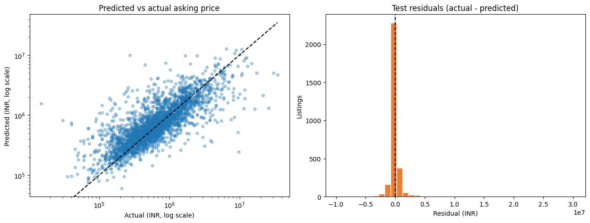

# Used-Car Price Prediction

An end-to-end regression project that estimates used-car asking prices from listing attributes. The notebook covers source validation, exploratory analysis, cleaning and feature engineering, leakage-safe preprocessing, model comparison and tuning, and evaluation on a held-out test set.

**Start here:** [Detailed project report](docs/PROJECT_REPORT.md) · [Run the notebook](Used_Car_Price_Prediction_Capstone.ipynb)

## Results at a glance

On a seeded 20% holdout of 2,998 listings, the tuned random forest achieved a mean absolute error (MAE) of **INR 453,857**, compared with **INR 678,667** for a training-median baseline. Its RMSE was INR 1,377,032 and R-squared was 0.346. Errors were substantially larger among the most expensive listings. These results describe this random split only; they are not a guarantee of future-market performance or a vehicle appraisal.



## Run it

Use Python 3.10 or later. From the repository directory:

```bash
python -m pip install -r requirements.txt
jupyter lab
```

Open `Used_Car_Price_Prediction_Capstone.ipynb` and run the cells from top to bottom. Keep `used_cars_dataset.xls` beside the notebook. Despite its extension, the supplied file contains comma-separated text; the notebook checks its file signature and reads it as CSV. A genuine `.xls` or `.xlsx` input is also supported.

## Project files

- `Used_Car_Price_Prediction_Capstone.ipynb` — executable analysis and model evaluation.
- `used_cars_dataset.xls` — supplied dataset.
- `docs/PROJECT_REPORT.md` — detailed methodology, results, figures, caveats, and data dictionary.
- `docs/images/` — exported exploratory and evaluation charts.

The dataset's original publisher, license, and representativeness have not been independently verified. The target currency is inferred from the rupee symbols and values in the file. See the [report](docs/PROJECT_REPORT.md#data-provenance-and-scope) before reusing or interpreting the data.
