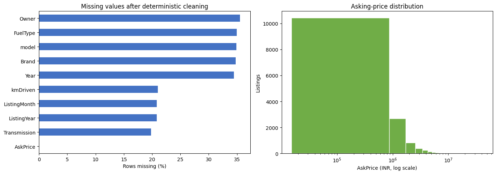
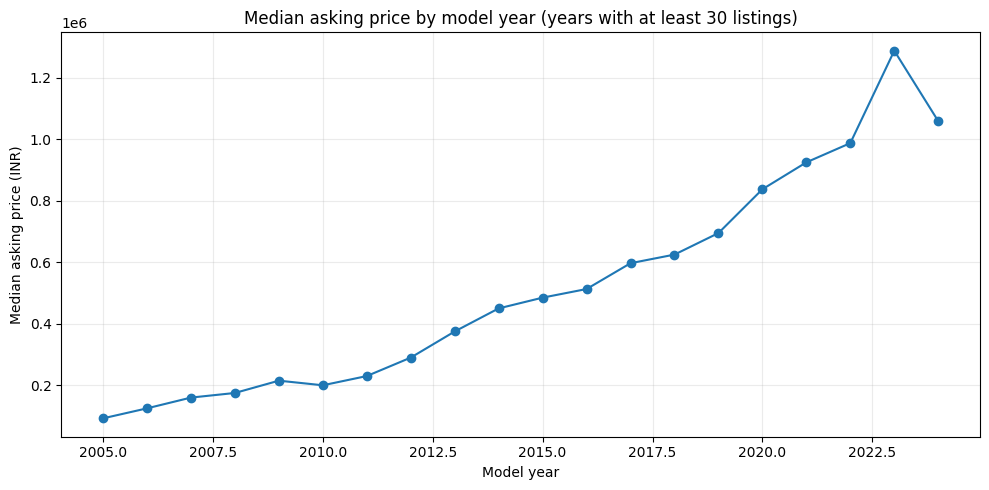
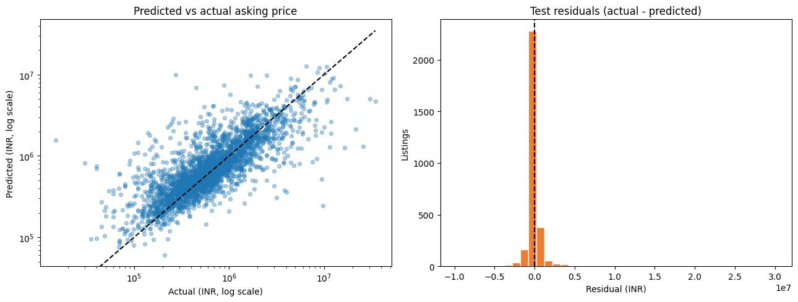

# Used-Car Price Prediction — Project Report

## Executive summary

This project tests whether the attributes in a used-car listing can estimate its advertised asking price. The supplied data has 24,575 rows and 11 columns. Removing exact duplicate rows left 14,988 listings for modeling. A preprocessing-and-regression pipeline was fit on a seeded training split, candidate models were compared by cross-validation, and the selected model was tuned without using the final test set.

The tuned random forest achieved an MAE of **INR 453,857** on 2,998 held-out listings, versus **INR 678,667** for a baseline that always predicts the training-set median. Its R-squared was **0.346**. This is a useful improvement over the baseline, but errors remain large in absolute terms and are concentrated in the highest-price range. The result is a classroom-style estimate on a random holdout, not a production appraisal.

## Data provenance and scope

The repository includes the file supplied with the project, `used_cars_dataset.xls`. Although named as an Excel file, its contents are comma-separated text; the notebook checks the file signature and selects the reader accordingly. The source publisher, collection method, usage license, market coverage, geography, and representativeness are not independently known. The target appears to be denominated in Indian rupees (INR), inferred from the source values.

The target `AskPrice` is a listing's asking price, not a verified sale or transaction price. No causal claim is made about the relationships in the data. Before redistributing or using the dataset outside this project, verify the original source and applicable data rights.

## Workflow

### 1. Validate and audit

- Required columns are checked before analysis; the notebook also records the source file's SHA-256 hash when run.
- **24,575** raw rows were present, of which **9,587** were exact full-row duplicates. These duplicates were removed before splitting to prevent identical records from appearing on both sides of evaluation.
- There were **no missing target values after numeric parsing**. Price strings were converted by removing currency symbols and separators; mileage strings were similarly parsed with units stripped.
- `Year` values were screened to the inclusive range **1980–2024**. The upper bound is the latest parseable listing year in this dataset; 1980 is an explicit screening choice, not a universal rule. Out-of-range and missing years are represented as missing for model-time imputation.
- Among rows with plausible `Year` and a reported `Age`, **100%** satisfy `Year + Age = 2024`. `Age` was therefore excluded as redundant; retaining the original model year avoids recalculating the age of historical listings against today's date.
- Empty and common “unknown” tokens in categorical features are treated as missing. Predictor missingness is imputed inside the model pipeline rather than dropping otherwise usable listings.

| Raw field | Missing rows | Missing |
|---|---:|---:|
| Owner | 10,626 | 43.2% |
| model | 10,431 | 42.4% |
| kmDriven | 6,231 | 25.4% |
| PostedDate | 6,220 | 25.3% |
| Age | 5,975 | 24.3% |
| Transmission | 5,922 | 24.1% |
| Brand | 5,269 | 21.4% |
| FuelType | 5,239 | 21.3% |
| Year | 5,179 | 21.1% |

### 2. Clean and construct features

After deduplication, the dataset contains **14,988 modeling rows**. `AskPrice` is the positive numeric target. No target outliers were removed: prices range from **INR 15,000 to INR 42,500,000**, and that skew is reflected in the metric interpretation.

The nine input columns are:

- Numeric: `Year`, `kmDriven`, `ListingYear`, `ListingMonth`
- Categorical: `Brand`, `model`, `Transmission`, `Owner`, `FuelType`

`ListingYear` and `ListingMonth` are derived from `PostedDate`. Free-text `AdditionInfo` was excluded from this first model. Numeric columns use training-fold median imputation with missingness indicators and standard scaling. Categorical columns use a “Missing” imputation value and one-hot encoding, with infrequent categories grouped and unknown categories ignored at prediction time.

### 3. Explore the data

The price histogram uses a logarithmic horizontal scale because asking prices are strongly right-skewed. The missingness plot reflects the cleaned feature table. Median price by model year is shown only for years with at least 30 listings; it is descriptive, not causal.

### 4. Compare, tune, and evaluate

The data was split once, with **11,990 training rows** and **2,998 test rows** (20%), using random seed 42. Three-fold shuffled cross-validation was applied to the training set. Imputation, scaling, and category encoding are part of the estimator pipeline, so each fold learns those transformations only from its training portion.

Ridge regression and a random forest were compared using cross-validated MAE, RMSE, and R-squared. A training-median `DummyRegressor` serves as a simple final test-set baseline. Random forest had the lowest cross-validation MAE and was selected. A four-iteration randomized search tuned `max_depth` and `min_samples_leaf` on training folds only; the selected settings were `max_depth=None` and `min_samples_leaf=1`.

| Model / evaluation | MAE (INR) | RMSE (INR) | R-squared |
|---|---:|---:|---:|
| Ridge, training 3-fold CV | 572,363 | 1,297,580 | 0.304 |
| Random forest, training 3-fold CV | 483,733 | 1,293,867 | 0.307 |
| Tuned random forest, best training CV | 480,151 | — | — |
| Training-median baseline, test set | 678,667 | 1,763,281 | -0.072 |
| Tuned random forest, test set | **453,857** | **1,377,032** | **0.346** |

The test MAE is about **33% lower** than the baseline MAE. MAE is the average absolute miss in INR, not the percentage of predictions that are correct. RMSE gives more weight to large misses; the gap between MAE and RMSE is consistent with occasional large errors in this skewed target. R-squared is not a percentage accuracy.

The held-out errors also varied by actual-price quartile:

| Actual-price quartile | Test listings | Median actual (INR) | Mean absolute error (INR) | Median absolute error (INR) |
|---|---:|---:|---:|---:|
| Up to 350,000 | 766 | 230,000 | 201,838 | 91,827 |
| 350,000–580,000 | 735 | 465,000 | 176,233 | 85,360 |
| 580,000–1,050,000 | 756 | 749,500 | 276,703 | 143,585 |
| Above 1,050,000 | 741 | 1,749,999 | 1,170,497 | 549,240 |

The highest-price quartile has much larger errors than the lower-price groups. This limits the model's usefulness for expensive listings and argues against treating an individual estimate as reliable without additional evidence.

## Interpretation and limitations

- The random split estimates performance on a similar mixture of listings. It does **not** establish performance in future months, another region, or for unseen vehicle types.
- The target is an advertised price rather than a confirmed transaction price; negotiation, condition, location, and other omitted factors may matter.
- Price values are highly skewed and include expensive outliers. The model was evaluated in INR without trimming those outcomes.
- The dataset has substantial missingness, especially for `Owner` and `model`. Imputation enables a complete pipeline but cannot recover missing information.
- `AdditionInfo` text was not modeled, and no geographic feature or condition assessment was available in the included feature set.
- The data's origin and licensing are unknown. Verify them before reuse or redistribution.
- A later-time-period holdout, external validation, verified sale prices, and a market/domain review are needed before any real-world use. Predictions should not be used as formal appraisals.

## Reproduce the analysis

1. Install the packages listed in [`requirements.txt`](../requirements.txt).
2. Keep `used_cars_dataset.xls` in the same directory as the notebook.
3. Run `Used_Car_Price_Prediction_Capstone.ipynb` from top to bottom.

The notebook fixes the random seed at 42. Cross-validation and randomized-search scores are computed during execution. Small differences may occur with different dependency versions or execution environments.

## Data dictionary

| Field | Role / treatment |
|---|---|
| `Brand` | Vehicle brand; categorical predictor |
| `model` | Vehicle model; categorical predictor |
| `Year` | Model year; numeric predictor after screening to 1980–2024 |
| `Age` | Audited for consistency with model year and excluded as redundant |
| `kmDriven` | Distance driven; parsed to numeric and negative values treated as missing |
| `Transmission` | Transmission category; categorical predictor |
| `Owner` | Owner category; categorical predictor |
| `FuelType` | Fuel category; categorical predictor |
| `PostedDate` | Listing date; parsed and transformed to `ListingYear` and `ListingMonth` |
| `AdditionInfo` | Free-text listing description; excluded from this model |
| `AskPrice` | Positive numeric asking price in inferred INR; prediction target |
